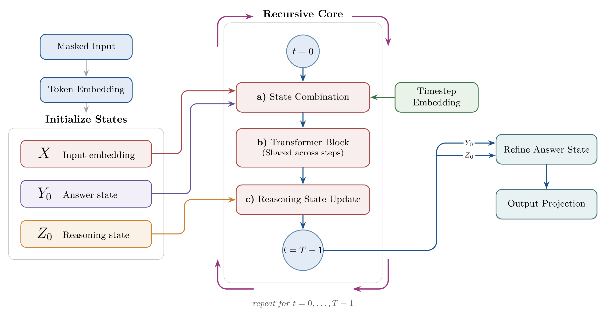

# TRLM: Tiny Recursive Language Model

**Shared-Weight Recursive Reasoning for Non-Autoregressive Language Generation**

> 🎉 Accepted to the **BabyLM Workshop @ EMNLP 2026**.
> 📄 Paper: [`paper/58_TRLM_Shared_Weight_Recursiv.pdf`](paper/58_TRLM_Shared_Weight_Recursiv.pdf)

TRLM is a small (~75M parameter) masked, non-autoregressive language model that gets more effective depth by **reusing the same Transformer block recursively** instead of stacking more layers. More recursion steps means more computation at inference time, with no additional parameters.

<p align="center">
  
</p>

## Key Ideas

- **Recursive latent reasoning.** The model keeps three states: the input embedding `x`, an answer state `y`, and a latent reasoning state `z`. A shared Transformer module refines `z` over `R` steps, and the answer is predicted from the final state.
- **Trajectory conditioning.** Each recursive step is conditioned on its normalized trajectory time `t` and step size `Δt` through adaptive layer normalization, so the same weights can act differently at early and late refinement stages.
- **Long–short trajectory training.** Each batch is run with a long (teacher) and a short (student) recursion schedule. Both get an answer-prediction loss, and a consistency loss pulls the short trajectory's representation toward the long one's. As a result, few steps already perform close to many.
- **Single-pass parallel decoding.** At inference the prompt stays visible, the answer span is filled with `[MASK]` tokens, and every masked token is predicted in one parallel pass after `R` latent refinement steps. `R` becomes a direct test-time compute knob.

## Results

All models are ~75M parameters, trained from scratch on the same ~1B-token OpenWebText + FineWeb-Edu mixture with the same tokenizer, then fine-tuned on GSM8K + SVAMP (numeric exact match).

| Model | Params | GSM8K | SVAMP | Avg. Gen. Time |
|---|---|---|---|---|
| GPT-2-style | 73.5M | 2.58% | 7.33% | 21.15 ms |
| Gemma-4-Text-style | 77.6M | **2.88%** | 6.33% | 53.47 ms |
| Mamba-2-style | 76.0M | 1.29% | 1.33% | 75.19 ms |
| Diffusion-Gemma-style | 74.3M | 0.99% | 3.00% | 728.31 ms |
| **TRLM** (r=1) | 74.5M | 2.73% | 8.33% | **11.06 ms** |
| **TRLM** (r=4) | 74.5M | 2.65% | **9.00%** | 25.86 ms |
| **TRLM** (r=8) | 74.5M | **2.88%** | 8.00% | 46.21 ms |

Accuracy is non-monotonic in recursion depth: GSM8K peaks at 8 steps and SVAMP at 4. See the paper for the full table and the trajectory-conditioning ablation.

## Repository Structure

```
configs/        Model and training configuration
data/           Pretraining datasets, collator, tokenizer training
models/         TRLM model, Transformer blocks, Triton kernels (RMSNorm, RoPE, SwiGLU)
training/       Trainer, losses, GSM8K/SVAMP fine-tuning, baseline pretraining scripts
inference/      Recursive masked generation
evaluation/     Evaluation and BabyLM export utilities
benchmark/      Benchmark scripts (e.g. LAMBADA)
visualization/  Log and benchmark plotting
paper/          Paper PDF and figures
```

## Usage

```bash
pip install -r requirements.txt
```

Set `HF_TOKEN` in a `.env` file, then:

**Pretraining**

```bash
python main.py --pretrain-datasets openwebtext,fineweb_edu
```

Use `--no-trajectory-conditioning` to train the ablation without trajectory conditioning, and `--min-recursions` / `--max-recursions` to set the recursion range.

**Fine-tuning and evaluation on GSM8K + SVAMP**

```bash
python training/finetune_math.py --model_type trlm --checkpoint_path <path/to/checkpoint.pt> --recursion_steps 8
```

The same script also fine-tunes the baselines (`gpt2`, `gemma4_text`, `mamba2`, `diffusion_gemma`) under the same prompts and metric.

## License

This project is licensed under the [Apache 2.0 License](LICENSE).
